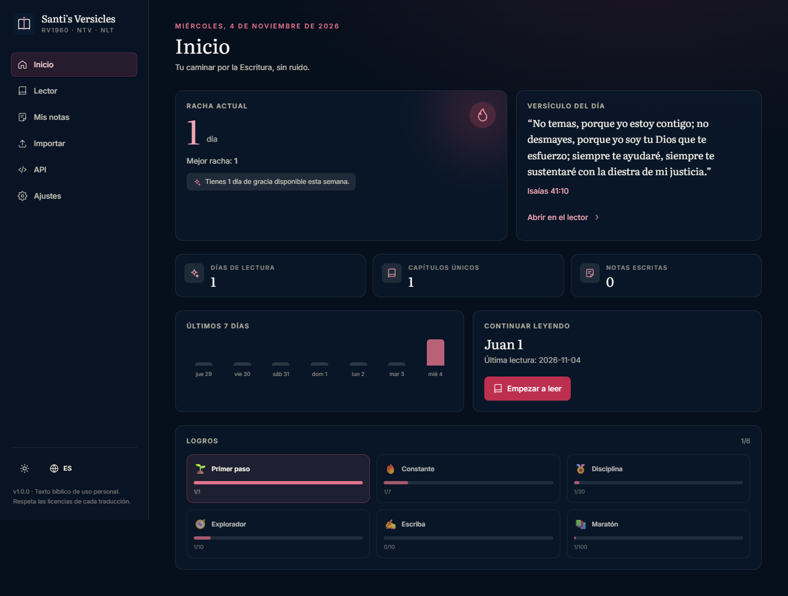
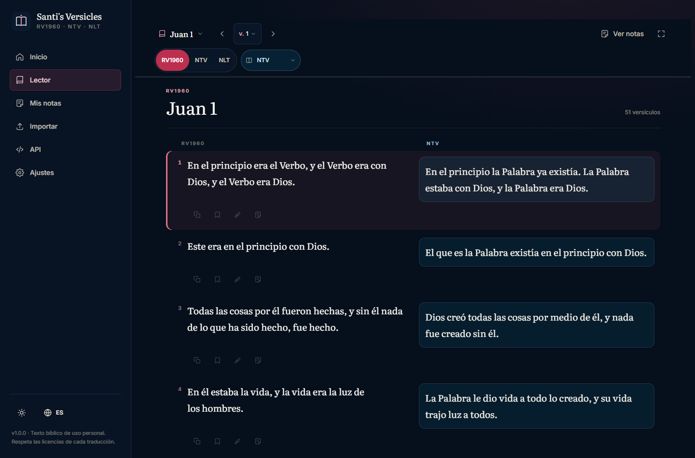
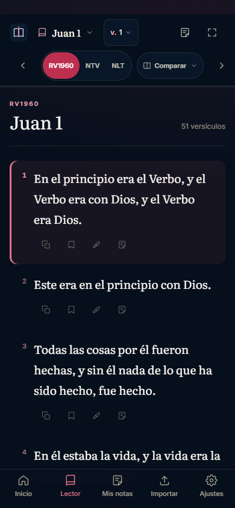
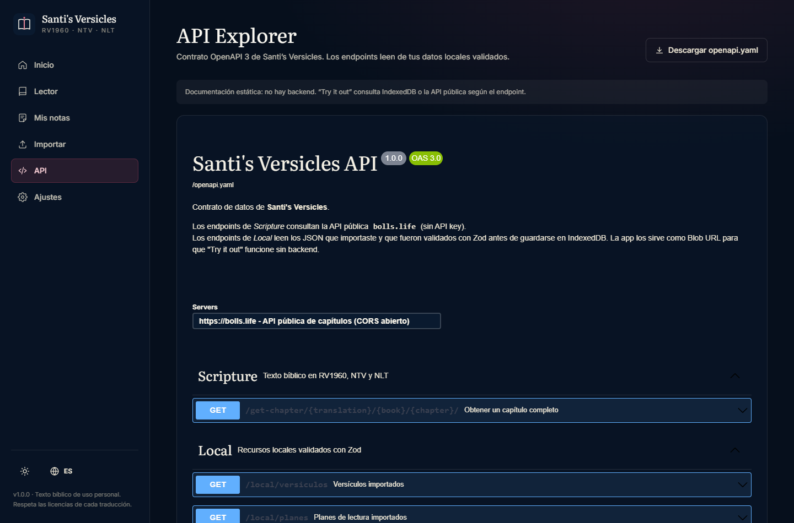

# Santi's Versicles · SV

SPA de estudio bíblico personal, silenciosa y sin distracciones. Lee en **RV1960, NTV y NLT**, compara traducciones, guarda notas y subrayados, mantén una racha de lectura y consulta el contrato de datos desde un **Swagger UI** integrado.

> Lectura profunda, un día a la vez.



## Características

- **Lector con barra fija**: referencia, capítulo anterior/siguiente, versículo actual y progreso siempre visibles. El versículo activo se marca mientras haces scroll.
- **Salto directo**: abre la referencia desde la barra y escribe `Juan 3:16`, `Sal 23` o `Rm 8:28`; también puedes saltar a cualquier versículo desde la cuadrícula `v. 12`.
- **Tres traducciones**: Reina-Valera 1960, Nueva Traducción Viviente y New Living Translation. Una traducción activa + comparación opcional en columnas, con panel azul para distinguir la versión secundaria.
- **Notas bajo demanda**: el cajón de notas solo aparece cuando lo abres; el texto y la comparación usan todo el ancho. Las notas guardadas se muestran en línea bajo su versículo.
- **Modo enfoque**: oculta el ruido visual para leer sin interrupciones.
- **Tipografía Literata + Inter**: serif de pantalla para la Escritura, sans neutra para la interfaz. Tamaño de texto ajustable.
- **Notas, subrayados y favoritos** por versículo, con etiquetas temáticas y búsqueda.
- **Exportación Markdown** de todas tus notas.
- **Racha con día de gracia semanal**: premia la constancia sin castigar el descanso.
- **Estadísticas y logros** calculados localmente.
- **Versículo del día** determinista, sin llamadas extra.
- **Importación JSON con File System Access API** (`showOpenFilePicker`) + arrastrar y soltar. Los handles se persisten en IndexedDB para reconectar el archivo en sesiones futuras.
- **Validación Zod en runtime** de cada JSON importado antes de guardarlo.
- **Swagger UI estático** sobre `public/openapi.yaml`. Los endpoints locales leen los JSON validados de IndexedDB y los sirven como Blob URL: “Try it out” funciona sin backend.
- **PWA instalable** con caché de capítulos para lectura offline.
- **Bilingüe ES/EN**, modo oscuro por defecto (azul profundo + rojo ember) y modo claro manual.
- **Movimiento con propósito**: fundido entre rutas, cajón deslizante, diálogos y popovers animados, versículo activo con transición y barra de progreso. Todo respeta `prefers-reduced-motion`.
- **Accesibilidad**: foco visible, áreas táctiles de 44 px, contraste AA y línea de lectura de 65–80 caracteres.



| Lector móvil | API Explorer |
| --- | --- |
|  |  |

## Stack

| Capa | Tecnología |
| --- | --- |
| Build | Vite 7 + TypeScript 5.9 (`strict`, `noUncheckedIndexedAccess`, `exactOptionalPropertyTypes`) |
| UI | React 19 + React Router 7 |
| Estilos | Tailwind CSS v4 (CSS-first) + `@tailwindcss/typography` |
| Estado | Store propio con `useSyncExternalStore` (sin librería externa) |
| Persistencia | IndexedDB (`idb`) + `localStorage` para preferencias |
| Validación | Zod 4 |
| Texto bíblico | API pública [bolls.life](https://bolls.life) (sin API key, CORS abierto) |
| Documentación API | Swagger UI React + OpenAPI 3.0.3 |
| PWA | `vite-plugin-pwa` + Workbox |
| Tests | Vitest + Testing Library · smoke tests con Playwright |

## Inicio rápido

Requisitos: **Node.js 20+** y npm.

```bash
npm install
npm run dev
```

Abre `http://localhost:5173`.

### Scripts

```bash
npm run dev        # servidor de desarrollo
npm run build      # typecheck + build de producción (dist/)
npm run preview    # sirve el build
npm run typecheck  # tsc -b --noEmit
npm run lint       # ESLint 9 (flat config)
npm run test       # Vitest
```

### Smoke tests (opcional)

Con el servidor de desarrollo levantado:

```bash
node scripts/smoke.mjs                 # rutas + capturas en smoke-output/
node scripts/smoke-interactions.mjs    # notas, subrayados, comparación, tema e idioma
node scripts/smoke-reader-redesign.mjs # referencia, versículo, notas, enfoque y móvil
node scripts/capture-docs.mjs          # capturas para docs/
```

Los scripts usan `playwright-core` con el canal `msedge`. Ajusta `SMOKE_BASE` si usas otro puerto.

## Arquitectura

```
src/
├── model/          # Dominio puro: tipos, canon, referencias, errores, constantes
├── controller/     # Orquestación: store, IndexedDB, API, importación, notas, preferencias
├── seguimiento/    # Rachas, estadísticas y logros
├── rsc/            # Recursos co-localizados: JSON + esquema Zod por carpeta
│   ├── versiculos/
│   ├── plan de lectura/
│   └── recordatorios/
├── ui/             # React: layout, páginas, componentes, hooks
├── i18n/           # Diccionarios ES/EN y helper de traducción
├── App.tsx
└── index.css       # Tokens de diseño Tailwind v4
```

Alias de importación: `@model`, `@controller`, `@seguimiento`, `@rsc`, `@ui`, `@i18n`.

### Regla de dependencias

```
ui ──▶ controller ──▶ model
 │          │
 │          └──▶ rsc (Zod)
 └──▶ seguimiento ──▶ model
```

- `model` no importa React, DOM ni APIs del navegador.
- `controller` es el único que toca IndexedDB, `fetch`, notificaciones y File System Access API.
- `rsc` mantiene el JSON y su esquema Zod en la misma carpeta. Los tipos se infieren del esquema.

### Flujo de datos

1. `bootstrapApp()` hidrata preferencias, notas, subrayados, favoritos, eventos y racha.
2. El lector pide un capítulo a `loadChapter()`:
   - IndexedDB → red (`bolls.life`) → validación Zod → normalización de HTML → caché.
3. La lectura registra un `ReadingEvent` determinista (`día:libro:capítulo:traducción`).
4. `buildStreakState()` recalcula la racha con día de gracia.
5. Las notas, subrayados y favoritos se guardan en IndexedDB y actualizan el store.

## Recursos `/rsc`

Cada carpeta contiene un `.mock.json` y su `schema.ts`. Al importar, el JSON se valida contra Zod; solo entonces se persiste la versión canónica.

### `versiculos`

```json
{
  "version": "1.0.0",
  "generatedAt": "2026-11-03T00:00:00.000Z",
  "verses": [
    {
      "bookNumber": 43,
      "chapter": 3,
      "verse": 16,
      "translations": {
        "RV1960": "Porque de tal manera amó Dios al mundo…",
        "NTV": "Pues Dios amó tanto al mundo…",
        "NLT": "For this is how God loved the world…"
      }
    }
  ]
}
```

### `plan de lectura`

```json
{
  "version": "1.0.0",
  "plans": [
    {
      "id": "juan-21-dias",
      "titleEs": "Juan en 21 días",
      "titleEn": "John in 21 days",
      "descriptionEs": "Un capítulo por día.",
      "descriptionEn": "One chapter per day.",
      "days": [
        {
          "day": 1,
          "labelEs": "El Verbo",
          "labelEn": "The Word",
          "readings": [{ "bookNumber": 43, "chapter": 1 }]
        }
      ]
    }
  ]
}
```

### `recordatorios`

```json
{
  "version": "1.0.0",
  "reminders": [
    {
      "id": "manana",
      "titleEs": "Tiempo con la Palabra",
      "titleEn": "Time in the Word",
      "messageEs": "Un capítulo te espera.",
      "messageEn": "A chapter is waiting.",
      "time": "07:00",
      "days": ["mon", "tue", "wed", "thu", "fri"],
      "enabled": true
    }
  ]
}
```

## File System Access API

- El botón de importación usa `window.showOpenFilePicker()`; **no** se usa `<input type="file">`.
- El `FileSystemFileHandle` se guarda en IndexedDB (`handles`).
- Al volver, “Reconectar” reutiliza el handle y solicita permiso de lectura dentro del gesto del usuario.
- Arrastrar y soltar usa `DataTransferItem.getAsFileSystemHandle()` para conservar el handle.
- Si el navegador no soporta la API (Firefox/Safari), la UI lo indica y deshabilita el flujo.

## Swagger UI

- Contrato: [`public/openapi.yaml`](public/openapi.yaml).
- Ruta de la app: `/api`.
- Endpoints `Scripture` → `https://bolls.life` (público).
- Endpoints `Local` → `https://local.santis/*`; un `requestInterceptor` los reescribe a Blob URLs generadas desde IndexedDB.
- Swagger UI se carga de forma diferida: no pesa en la carga inicial.

## PWA y offline

- El service worker precarga el shell y aplica `StaleWhileRevalidate` a los capítulos de `bolls.life`.
- Un capítulo leído queda disponible offline.
- `registerType: 'autoUpdate'`.
- Manifest con iconos `any` y `maskable`.

## Despliegue en Vercel

El repo incluye `vercel.json`:

- Framework: Vite
- Build: `npm run build`
- Output: `dist`
- Rewrite SPA: `/(.*) → /index.html`
- Cache inmutable para `/assets/*`, sin caché para `/sw.js`

Pasos:

1. Importa el repositorio en Vercel.
2. Selecciona la carpeta `pagina para estudiar la biblia` como **Root Directory**.
3. Vercel detecta Vite; confirma build `npm run build` y output `dist`.
4. Despliega.

## Privacidad y derechos

- **Sin backend, sin cuentas, sin analytics.** Todo vive en tu navegador.
- El texto bíblico se consulta a `bolls.life`; la app solo cachea capítulos leídos.
- RV1960, NTV y NLT están protegidas por derechos de autor. Esta app está pensada para **uso personal y devocional**. Respeta las licencias de cada traducción.
- Los JSON que importas son tuyos y no salen del dispositivo.

## Limitaciones conocidas

- **File System Access API** solo está disponible en navegadores basados en Chromium (Chrome/Edge). En Firefox/Safari puedes leer y tomar notas, pero no importar archivos.
- **Notificaciones**: el scheduler funciona mientras la app está abierta. Sin backend ni Push API no hay recordatorios con la app cerrada.
- **Dependencia externa**: si `bolls.life` no responde y el capítulo no está en caché, el lector muestra un error reintentable.
- **Swagger UI** añade ~1.5 MB al chunk de `/api`; está aislado y solo se descarga al entrar.
- La racha usa la zona horaria local del dispositivo.

## Documentación de diseño

Las decisiones de arquitectura, trade-offs y criterios de calidad están en [`docs/DESIGN.md`](docs/DESIGN.md).

## Licencia

Proyecto personal. El código se comparte tal cual; el texto bíblico conserva sus licencias originales.
